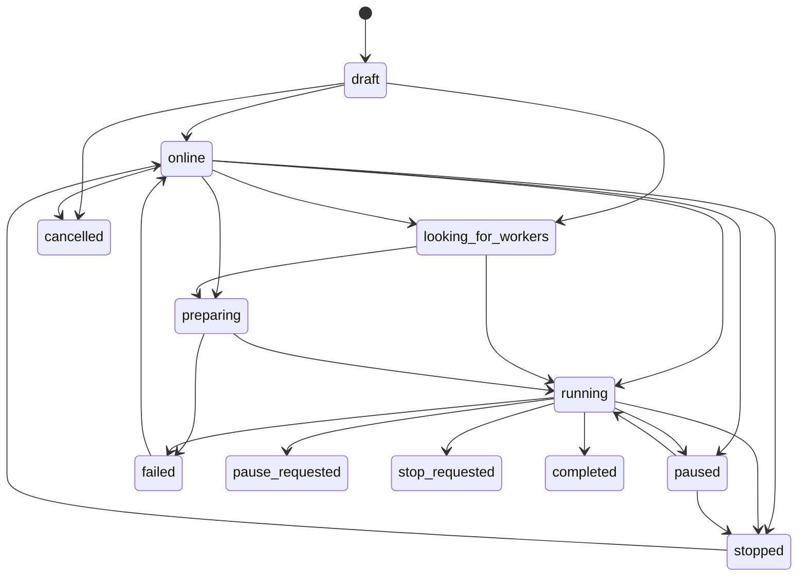
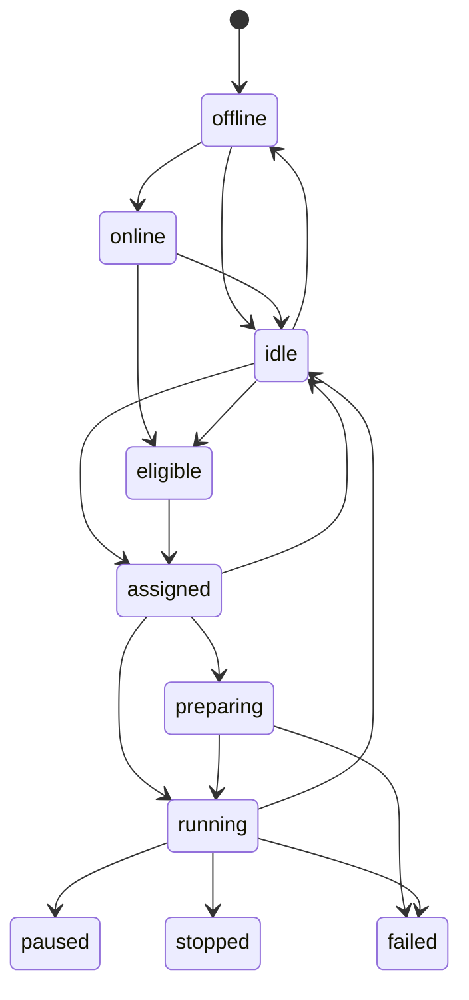
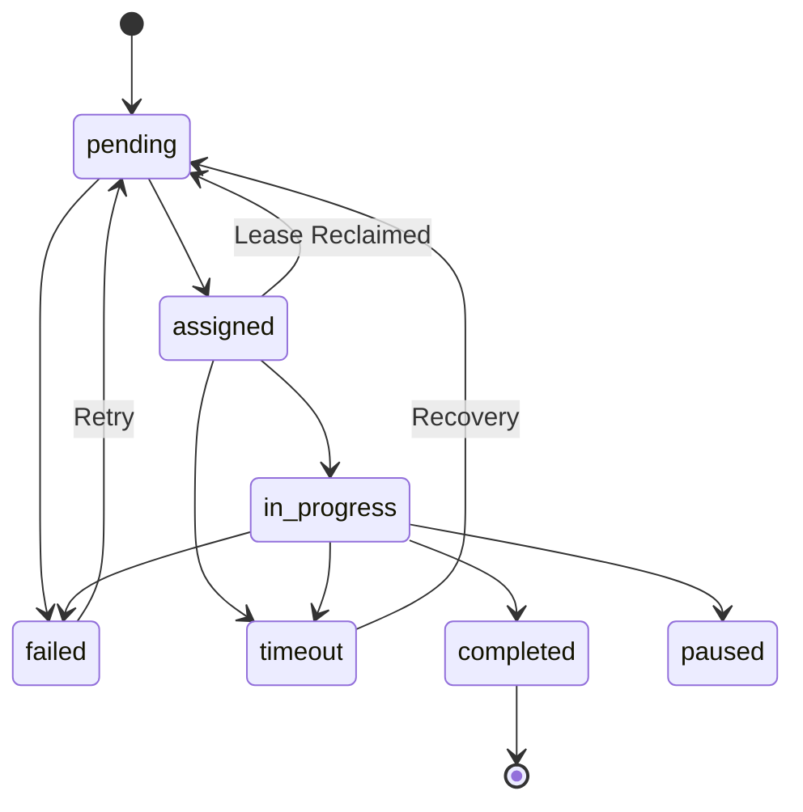

# Scheduler, State Machines, Training Tasks, Leases, and WebSockets (Phase 6)

## Overview

ADC implements a production-grade distributed training coordinator and scheduler. The system governs distributed workloads through:
1. **Explicit Finite State Machines (FSM)** for projects, workers, and training tasks, preventing contradictory cluster states.
2. **Deterministic Strategy Selector**, selecting between `single_node`, `data_parallel`, `model_parallel`, and `independent_jobs` based on cluster capacity and model characteristics.
3. **Worker Eligibility Evaluator**, validating connectivity, active roles, global contribution flags, and compute requirements before task assignment.
4. **Training Scheduler & Single-Use Task Leases**, dispatching sequential training step slices with lease timeouts, heartbeats, and progress metrics.
5. **Failure & Recovery Manager (`reclaim_expired_leases`)**, automatically recovering abandoned or timed-out tasks back to the queue when workers disconnect or fail.
6. **Real-Time WebSocket Event Hub (`WebSocketHub`)**, broadcasting live training progress, metric telemetry, and agent commands with standardized event envelopes.

---

## 1. Explicit State Machines

The state machines are defined in `app/core/state_machine.py`. Every transition is validated against an explicit directed graph, raising `ConflictError` (HTTP 409) if an invalid transition is attempted.

### Project State Machine



### Worker State Machine



### Training Task State Machine



---

## 2. Deterministic Strategy Selector

Per specification, scheduling strategy is determined deterministically without nondeterministic external LLMs:

| Strategy | Conditions |
| :--- | :--- |
| `single_node` | Number of eligible workers $\le 1$ |
| `data_parallel` | Project explicitly requests `data_parallel` or `ddp`, and $\ge 2$ workers are available |
| `model_parallel` | Model architecture contains `70b` or `large`, and total cluster VRAM $\ge 48.0\text{ GB}$ |
| `independent_jobs` | Multiple workers available for standard parallel batch steps |

---

## 3. Worker Eligibility Evaluation

Workers are screened before task assignment:
1. **Machine Active Role:** Must be `'worker'`. Machines in `'master'` or `'none'` roles are excluded.
2. **Connectivity:** Must be online and not marked offline.
3. **Global Pause:** If `MachineContributionSettings.global_paused` is `True`, the worker is skipped.
4. **Project Membership:** Must have `contribution_status == "active"` and membership status not in `["paused", "offline", "stopped"]`.
5. **Resource Minimums:** Must satisfy `cpu_cores_contributed >= project.min_cpu_cores` and `ram_contributed_gb >= project.min_ram_gb`.
6. **GPU Requirements:** If project requires GPU, worker must have GPU contribution enabled.

---

## 4. Single-Use Task Leases & Dispatch

When a worker queries `GET /api/v1/agent/tasks`:
1. The scheduler scans for pending tasks or creates the next step slice (`step_start` to `step_end = min(total_steps, step_start + step_batch_size)`).
2. It assigns the task to the requesting worker, generating a single-use cryptographically random lease token:
   ```
   task_lease_<48-hex-chars>
   ```
3. A lease expiry timestamp is set (`now + lease_duration_seconds`).
4. Worker acknowledges via `POST /api/v1/agent/tasks/{task_id}/acknowledge`, confirming execution and transitioning the task to `in_progress`.
5. If the lease expires without progress or completion, `scheduler.reclaim_expired_leases(db)` resets the task to `pending`, clears the assignment and lease token, and allows other eligible workers to take over.

---

## 5. Telemetry & Metrics Pipeline

During step execution:
1. Worker sends telemetry snapshots via `POST /api/v1/agent/tasks/{task_id}/metrics`:
   ```json
   {
     "step": 25,
     "loss": 0.425,
     "speed": 18.2,
     "clusterCpuUtil": 45.0,
     "clusterGpuUtil": 88.0,
     "ramUtilGB": 4.2
   }
   ```
2. The endpoint persists a `TrainingMetric` database record and updates `TrainingRun.current_step`, `TrainingRun.current_loss`, and `TrainingRun.training_speed`.
3. Simultaneously, `ws_hub.broadcast_website_event` emits a `training_progress` event over WebSockets to all subscribed browser sessions.
4. On batch completion, worker calls `POST /api/v1/agent/tasks/{task_id}/status` with `{"status": "completed"}`, marking the task completed, advancing the run step, and transitioning worker membership back to `idle`.

---

## 6. WebSocket Streaming Hub

The WebSocket Hub (`app/core/websocket.py` and `app/api/routes/websocket.py`) manages real-time event streams:

- **Browser Events:** `/ws/events` and `/api/v1/ws/events`
  - Authenticated via JWT bearer token in query parameter (`?token=...`) or `access_token` cookie.
  - Subscribes to global updates or project-specific rooms (`?project_id=...`).
- **Agent Command Stream:** `/ws/agent` and `/api/v1/ws/agent`
  - Authenticated via `installation_id`.
  - Dispatches direct control signals (task assignments, pause, resume, checkpoint requests).

### Standard Event Envelope

```json
{
  "event": "training_progress",
  "event_id": "evt_9f3b14a2cd18",
  "timestamp": "2026-10-19T03:45:00.000000+00:00",
  "entity_id": "3ccbd3a5-1fee-49b0-8efb-c7d966146bc1",
  "payload": {
    "project_id": "3ccbd3a5-1fee-49b0-8efb-c7d966146bc1",
    "current_step": 25,
    "loss": 0.425,
    "speed": 18.2,
    "total_steps": 200
  }
}
```
